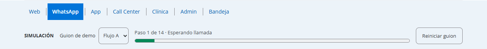

# Barra de demo — ajuste 3 autorizado (D5)

Fecha: 2026-11-25. Cambio `marca-salud-digna-360`. Ajuste solicitado y autorizado en esta sesión: azul claro continuo, sin cajas y con divisores verticales. Base: `0b59599722ae1999ba24f61d7399b8a007b92bac`, más los archivos sin commit del manifiesto `04-archivos-entregados.json`. Chrome instalado, con Playwright 1.56.1 temporal, sin dependencias nuevas del proyecto. La evidencia de la variante anterior queda en `revision-2/`.

## Reproducción

Se levantaron dos Vite con el código actual: `VITE_API=mock` en `http://localhost:5174` y `VITE_API=real` en `http://localhost:5173`. Se usó la caché de Corepack ya instalada, sin descargar paquetes:

```powershell
$env:COREPACK_HOME='C:/Users/Luis Rodriguez/AppData/Local/node/corepack'
# En terminales separadas:
$env:VITE_API='mock'; corepack pnpm --filter @noki/web dev --port 5174
$env:VITE_API='real'; corepack pnpm --filter @noki/web dev --port 5173
# Desde la raíz, con los servidores activos:
$env:NOKI_BROWSER_TOOLS='C:/Users/Luis Rodriguez/AppData/Local/Temp/noki-marca-browser'
node openspec/changes/marca-salud-digna-360/evidencias/barra.mjs
```

El script conserva las acciones existentes: A avanza con «Llamada entrante»; C con «Cancelar cita» y «Confirmar cancelación». Navega a WhatsApp con la barra, comprueba que el paso no cambió y vuelve al canal de origen. También prueba el selector, el reinicio, hover y Tab. En modo real solo navega: no envía comandos de negocio a la API.

## Resultado

**PASS: 54 comprobaciones de disposición**, en [05-resultados.json](05-resultados.json), con salida de ejecución en [05-ejecucion.txt](05-ejecucion.txt):

- Las ocho rutas se revisaron a 375 × 812 y 1280 × 900 px en ambos modos: 32 comprobaciones iniciales. Se añadieron 16 estados capturados (A/C, pasos 1/2, canal de origen y WhatsApp, ambos tamaños) y seis comprobaciones adicionales de `/wa` a 320, 767 y 768 px en ambos modos.
- No hay desplazamiento horizontal de la página. En móvil, los canales conservan la fila desplazable interna prevista en D5; la franja no se desplaza horizontalmente.
- Los siete canales no tienen borde ni radio; su separación es de 8 px y el área táctil es al menos 44 × 44 px. Entre ellos hay seis divisores verticales de 1 × 20 px, centrados, con `--borde-control`. El actual tiene fondo azul de acción, texto blanco y peso 600. Hover de otro canal usa el fondo interactivo.
- En simulado aparecen «Simulación», el selector, el estado anunciado y el progreso nativo con nombre asociado al estado: 1/14 y 2/14 en A, 1/4 y 2/4 en C. Toda la barra usa el mismo fondo `--sd-fondo-suave` (`rgb(236, 243, 249)`), sin borde superior verde ni recuadro en la etiqueta; el reinicio permanece a la derecha. El relleno y la pista se comprobaron visualmente y sus variables/contrastes en `identidadVisual.test.ts`; los pseudo-elementos internos de `<progress>` no se miden mediante `getComputedStyle`, que no expone su estilo real en Chrome.
- En real solo aparecen los canales; sin etiqueta, selector, estado, progreso ni reinicio de guion.
- Tab muestra un anillo azul de 3 px, también sobre el canal activo. El foco está dentro de la ventana y no se recorta por la fila desplazable.
- En móvil, la barra está fija al pie y su altura medida por `ResizeObserver` reserva el espacio correspondiente. En A y C inicial mide 196 px; en el texto más largo de C, paso 2, 215.5 px. El compositor termina exactamente donde empieza la barra (y = 616 o 596.5 px, respectivamente), con «Enviar» visible y sin otro elemento encima. En real la barra mide 61 px y el compositor termina en y = 751 px. En simulado el campo recibe texto y «Enviar» se habilita.
- A 767 px sigue fija; a 768 px cambia a sticky arriba. No se observaron excepciones JavaScript ni peticiones a terceros: solo origen de la web y API configurada en localhost:4000.

Este recorrido comprueba la barra y sus interacciones de demo; no sustituye un ensayo de negocio integral con la API real ni una prueba en un teléfono físico con teclado virtual.

## Capturas

Capturas de ventana, sin datos personales reales. El valor completo y el nombre accesible del progreso están en el JSON y en las pruebas.



| Estado | Canal de origen · 375 px | WhatsApp · 375 px | Canal de origen · 1280 px | WhatsApp · 1280 px |
|---|---|---|---|---|
| A · paso 1/14 | [Call Center](05-mock-375-flujoA-paso1-callcenter.png) | [WhatsApp](05-mock-375-flujoA-paso1-wa.png) | [Call Center](05-mock-1280-flujoA-paso1-callcenter.png) | [WhatsApp](05-mock-1280-flujoA-paso1-wa.png) |
| A · paso 2/14 | [Call Center](05-mock-375-flujoA-paso2-callcenter.png) | [WhatsApp](05-mock-375-flujoA-paso2-wa.png) | [Call Center](05-mock-1280-flujoA-paso2-callcenter.png) | [WhatsApp](05-mock-1280-flujoA-paso2-wa.png) |
| C · paso 1/4 | [App](05-mock-375-flujoC-paso1-app.png) | [WhatsApp](05-mock-375-flujoC-paso1-wa.png) | [App](05-mock-1280-flujoC-paso1-app.png) | [WhatsApp](05-mock-1280-flujoC-paso1-wa.png) |
| C · paso 2/4 | [App](05-mock-375-flujoC-paso2-app.png) | [WhatsApp](05-mock-375-flujoC-paso2-wa.png) | [App](05-mock-1280-flujoC-paso2-app.png) | [WhatsApp](05-mock-1280-flujoC-paso2-wa.png) |

| Modo | WhatsApp · 375 px | WhatsApp · 1280 px |
|---|---|---|
| Real | [Sin simulación](05-real-375-inicial-wa.png) | [Sin simulación](05-real-1280-inicial-wa.png) |
| Foco · simulado | [Tab](05-mock-375-foco-wa.png) | [Tab](05-mock-1280-foco-wa.png) |
| Foco · real | [Tab](05-real-375-foco-wa.png) | [Tab](05-real-1280-foco-wa.png) |

[Antes del ajuste 3 · 375 px](05-antes-375.png). En la revisión visual se contrastaron las capturas móviles, escritorio, foco y el texto más largo de C con los valores calculados. El detector mecánico de Impeccable solo señaló Open Sans como fuente frecuente; se conserva porque D2 la exige, sin cambiar la identidad aprobada.
